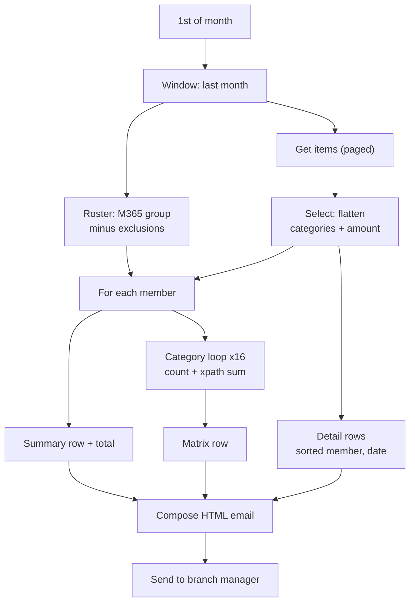

# Branch Referrals: Monthly Team Activity Report

On the first of each month, this flow emails a branch manager a complete activity report for the previous month: per-person totals, a 16-category matrix of counts and dollars closed, and a sorted detail table. Every figure is computed directly from list data.

**Connectors:** SharePoint · Office 365 Groups · Office 365 Outlook  
**Trigger:** Recurrence, monthly on day 1 (Eastern)  
**Size:** 29 actions

## The problem

Branch managers filtered the referral list by hand every month to count what each team member logged, and then built the summary themselves. It took time, the format varied, and the multi-select *Category* column made accurate counting by category hard.

## What it does

1. **Sets the reporting window** to the previous calendar month (`startOfMonth(subtractFromTime(utcNow(), 1, 'Month'))` to `startOfMonth(utcNow())`).
2. **Builds the roster** from the team's Microsoft 365 group, minus a configurable exclusion list.
3. **Pulls the month's items** with pagination up to 5,000.
4. **Flattens each item** in one Select. The multi-select categories become a single comma-separated string, and the amount becomes a number.
5. **Builds the per-member sections,** looping over the roster with concurrency 1:
   - A summary row with that member's total actions.
   - If the member had any activity, a matrix row. The flow loops the 16 categories, counts matching items, and sums dollars with an `xpath(... 'sum(//n)')` expression.
6. **Builds the detail table,** sorted by member and then date.
7. **Sends one inline-styled HTML email** that renders in Outlook.

## Architecture



## Key design decisions

| Decision | Why |
|---|---|
| **Deterministic figures only** | An AI Builder *Run a prompt* step was evaluated to write a narrative summary. It was excluded after repeated runs made up names, counts and dollar figures. In a report managers use for goals, a fabricated number is worse than no summary. |
| **Flatten multi-select once,** in a Select | Later filters run against one string field instead of nested arrays, and the flatten logic lives in one place. |
| **`xpath` sum** over a JSON-to-XML conversion | Expressions have no native `sum()`, and a loop with an accumulator variable would add hundreds of actions per run. |
| **Trim zero-activity rows** from the matrix | Keeps a 17-column table readable. The summary table still lists everyone. |
| **A separate copy per team** instead of one parameterized flow | Teams want their reports customized. Each copy changes six documented values: group, exclusions, team name, recipients, item scope and connections. |
| **Concurrency 1** on both loops | Parallel iterations appending to the same string variable drop and garble rows. |

## Lessons from the build

- **The matrix initially covered only the referral categories.** One member had three interactions, but the matrix showed two. The category array was expanded to all 16 categories, and a footnote now explains that multi-category items count in each column.
- **Loop naming collisions.** With default names (`Apply_to_each`, `Apply_to_each_1`), it's easy to reference the wrong loop. Loops now get descriptive names.
- **Select's key/value mode** rejects a bare expression. Text mode is needed to output a plain array.
- **OData datetime filtering** took several rounds before the month window was reliable.
- **API request budget.** The nested loops cost about 700 to 1,000 requests per run. Per-team copies should run at staggered times, and the service account's license tier matters, because daily request limits differ by tier.
- **A constraint to know about:** category matching uses `contains()`, so no category name can be a substring of another.

## Configuration

| Environment variable | Purpose |
|---|---|
| `plb_AutomationSiteUrl`, `plb_ReferralTrackerList` | Source list |
| `plb_ReportTeamGroupId` | Microsoft 365 group whose members are the roster |
| `plb_ReportRecipients` | Report recipients |

The 16 category names in `RefCategories` must match the list's choice values, and the matrix header order must match the array order.

## Action outline

<details>
<summary>Expand the full action tree</summary>

<!-- outline:start -->
```text
Recurrence · Recurrence (Month, Eastern Standard Time)
├─ Compose_-_ReportStart · Compose
├─ Compose_-_ReportEnd · Compose
├─ Initialize_RefCategories · Initialize variable
├─ Initialize_Exclusions · Initialize variable
├─ Initialize_HtmlRows · Initialize variable
├─ Initialize_MatrixRows · Initialize variable
├─ Initialize_RowCells · Initialize variable
├─ Initialize_TotalCount · Initialize variable
├─ List_group_members · Office 365 Groups: List group members
├─ Get_items_-_Last_month · SharePoint: Get items  (pagination 5000)
├─ FlatItems · Select
├─ Apply_to_each_-_Team_member · Apply to each  (concurrency 1)
│  └─ Condition_-_Not_excluded · Condition
│     └─ If yes
│        ├─ EmpName · Compose
│        ├─ EmpItems · Filter array
│        ├─ Append_to_HtmlRows · Append to string
│        ├─ Increment_TotalCount · Increment variable
│        └─ Condition_-_Has_activity · Condition
│           └─ If yes
│              ├─ Set_RowCells · Set variable
│              ├─ Apply_to_each_-_Category · Apply to each  (concurrency 1)
│              │  ├─ CatItems · Filter array
│              │  ├─ CatAmounts · Select
│              │  └─ Append_to_RowCells · Append to string
│              └─ Append_to_MatrixRows · Append to string
├─ Select_-_Detail_rows · Select
├─ Select_-_Sorted_detail_rows · Select
├─ Compose_-_DetailRows_HTML · Compose
├─ Compose_-_EmailBody · Compose
└─ Send_an_email_(V2) · Outlook: Send an email (V2)
```
<!-- outline:end -->

</details>

## Reconstruction notes

- **Category names** are generalized.
- **"Member" vs. "Logged by":** the member is read from a `TeamMember` person column, falling back to Created By, while Logged By is always Created By.
- **The run time** (6:00 AM) is representative.
