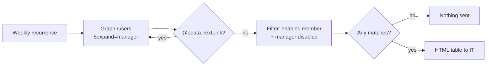

# AD Hygiene: Users Reporting to a Disabled Manager

A weekly identity-hygiene check. It finds enabled staff accounts whose manager in the directory is a disabled account, and emails IT only when there's something to fix.

**Connectors:** Office 365 Users (Send an HTTP request to Microsoft Graph) · Office 365 Outlook  
**Trigger:** Recurrence, Mondays 7:00 AM Eastern  
**Size:** 12 actions

## The problem

When a manager leaves, their account is disabled, but their direct reports' *Manager* attribute often isn't updated. Every flow that uses **Get manager** then routes approvals to a dead mailbox. That happened twice in the [approval flow](../professional-development-approvals/) before this report existed.

Reporting-line changes are part of the offboarding ticket, but with that many offboarding steps, they get missed.

## What it does

1. **Pulls every user and their manager in one Graph query per page,** using `$expand=manager($select=displayName,mail,accountEnabled)`.
2. **Pages through `@odata.nextLink`** until it's empty, merging each page into one array.
3. **Filters** for enabled `Member` accounts (not guests) whose manager has `accountEnabled = false`.
4. **Reports only when there are matches.** If anything matches, it builds an HTML table (employee, email, department, disabled manager) and emails IT. A clean week sends nothing.

The first production run found **nine employees reporting to three departed managers.**

## Architecture



## Key design decisions

| Decision | Why |
|---|---|
| **Graph through the Office 365 Users connector** | There's no server, scheduled PowerShell task or SMTP relay to maintain, and no premium connector. Manager and enabled status already sync from on-premises AD to Entra ID. |
| **`$expand` the manager** | One call per page instead of one Get manager call per user. |
| **Report only when non-empty** | Anything that lands in the inbox is real work, so the report doesn't become noise people learn to ignore. |
| **Users with no manager are excluded on purpose** | Executives and service accounts would show up every week as noise. That's a separate check, with an exclusion list if it's ever wanted. |
| **The fix happens at the source** | The email tells IT to correct the attribute in on-premises AD. It syncs on the next Entra Connect cycle, and failed runs can then be resubmitted. |

## Lessons from the build

- **`$expand` caps each page at 100 results and ignores `$top=999`.** The first test came back with a `nextLink` partway through the alphabet. Paging is required.
- **A hardcoded URI inside the loop** fetched the same first page 60 times. The loop has to call `variables('nextLink')`.
- **Set variable can't reference the variable it's setting,** so each page is merged in a Compose (`union(...)`) first.
- **A leading space** in the Filter array's advanced-mode expression made it invalid.

## Roadmap

- **Route findings to Jira Service Management** instead of email, so each fix has a ticket and an audit trail. This would use search-before-create to avoid duplicates, and an API token owned by a service account rather than a person.
- **Evolve into a quarterly user access review.** Managers would attest to their reports' access, with responses logged as examination evidence.

## Configuration

| Environment variable | Purpose |
|---|---|
| `plb_TechOpsEmail` | Report recipient |

## Action outline

<details>
<summary>Expand the full action tree</summary>

<!-- outline:start -->
```text
Recurrence · Recurrence (Week, Eastern Standard Time)
├─ Initialize_nextLink · Initialize variable
├─ Initialize_allUsers · Initialize variable
├─ Do_until_-_All_pages · Do until  (count 60, timeout PT1H)
│  ├─ Send_an_HTTP_request · Office 365 Users: Send an HTTP request (Graph)
│  ├─ Merge · Compose
│  ├─ Set_allUsers · Set variable
│  └─ Set_nextLink · Set variable
├─ Filter_array · Filter array
└─ Condition_-_Any_matches · Condition
   └─ If yes
      ├─ Select · Select
      ├─ Create_HTML_table · Create HTML table
      └─ Send_an_email_(V2) · Outlook: Send an email (V2)
```
<!-- outline:end -->

</details>

## Reconstruction notes

- The Graph `$select` here also includes `department`, which feeds an extra report column.
