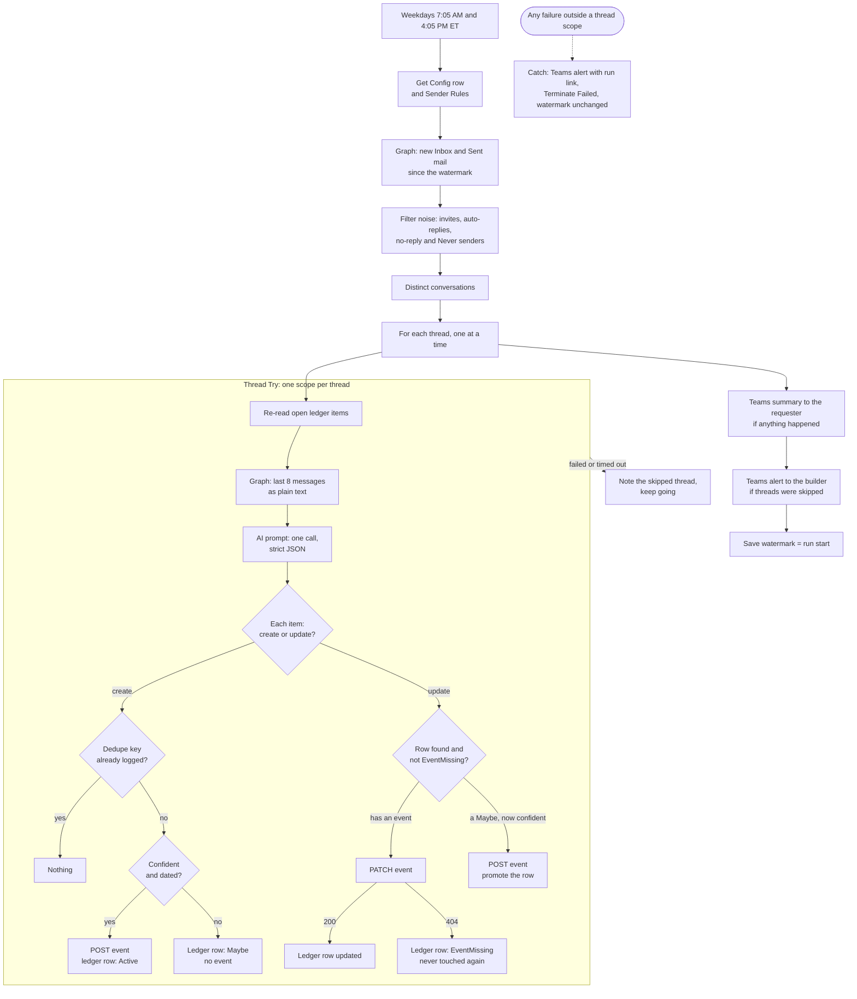

# Email Due Dates: Calendar Events from Email Threads

Twice each weekday, this flow reads one staff member's new Inbox and Sent mail, makes one AI prompt call per email thread to find work that's theirs and has a due date, and puts each one on their calendar with a reminder. There are no approvals and no duplicates, and an event they delete stays deleted.

**Connectors:** Office 365 Outlook (Send an HTTP request to Microsoft Graph) · AI Builder (Run a prompt) · SharePoint · Microsoft Teams  
**Trigger:** Recurrence, weekdays at 7:05 AM and 4:05 PM Eastern  
**Size:** 85 actions  
**Status:** tested build, pilot pending ([test status](#test-status))  
**Source:** a sanitized solution export of the tested build, not a reconstruction ([notes](#sanitization-notes))

## The problem

Due dates get buried in email. A request arrives with "by Friday" in the third paragraph, a reply moves it to Monday, and neither one reaches a calendar. The staff member who asked for this wanted it handled with zero touch:

- **Automatic.** Events appear on their own, with no approval step and no review queue.
- **No duplicates.** That is the acceptance test: a week on a test calendar with zero duplicates and only events they'd actually want.
- **An event on the due date, with a heads-up.** A day ahead for small items and longer for big ones.
- **Their mailbox only,** under their own account.
- **Adjustable later.** Requests sent to a group count as theirs for now. Some senders should always count and some never should, and that list wasn't known yet.

## What it does

1. **Reads its settings.** One Config row holds every threshold and the watermark. Sender Rules rows are split into an Always list and a Never list.
2. **Gets new mail since the watermark** from Inbox and Sent Items, with two Graph calls through the Outlook connector.
3. **Filters noise before the AI sees anything:** calendar invites, auto-replies, no-reply senders and Never senders. Always senders pass regardless.
4. **Groups by conversation.** Ten new emails in one thread become one AI call.
5. **Handles each thread in its own scope,** one thread at a time:
   - Re-reads the open items in the ledger, so a row created earlier in the same run is visible.
   - Pulls the thread's last 8 messages as plain text, new text only, each stamped with its weekday and sent time.
   - Reads the ledger rows already tracked for the thread, whatever their status.
   - Calls the prompt once. It returns strict JSON: a list of `create` and `update` items with a title, date, time, size, confidence and a short quote as evidence.
6. **Acts on each item with fixed logic:**
   - **create:** if no ledger row has the same dedupe key, and the item is dated and above the confidence threshold, it creates the event and logs an `Active` row. An uncertain item is logged as `Maybe`, with no event.
   - **update:** only against a row that exists and isn't marked `EventMissing`. It PATCHes the existing event, so a moved date moves the same event. A 404 marks the row `EventMissing`. A `Maybe` row that's now confident gets its event and is promoted.
7. **Reports in Teams.** The requester gets a summary of what was added, updated or left as a possible item, and only when there's something to report. The builder gets a list of any threads that were skipped.
8. **Saves the watermark last.** If anything in the main scope fails, the watermark stays put, the builder gets a Teams alert with a run link, and the run ends as *Failed*.

## Architecture



## Key design decisions

| Decision | Why |
|---|---|
| **A flow with one prompt call per thread, not an agent** | The AI only judges: is this theirs, what's the date, is it already tracked. Every create, update and skip is fixed flow logic. That split is what makes "no duplicates" testable, because the dedupe checks are expressions that can be read and re-run, not model behavior that has to be trusted. An earlier flow here [rejected an AI step](../branch-activity-report/#key-design-decisions) that was asked to write figures. Here the model proposes and the flow decides. |
| **Three layers of dedupe** | (1) The prompt is shown what's already tracked, for this thread and across threads, and told to leave it out. (2) Before every create, the flow looks up a `DedupeKey` (due date plus the first 30 characters of the normalized title) in the ledger. (3) Rows marked `EventMissing` still count as tracked but are excluded from updates, so an event the requester deleted is never recreated or touched again. |
| **A SharePoint list as the ledger** | The calendar can't answer "did the flow already create this, and was it deleted on purpose?" The list can, because the flow never deletes a row. It also gives the requester an Upcoming view and gives testing a dashboard. |
| **Watermark saved only on success, with Try/Catch** | `Save Watermark` is the last action in Try, and it writes the run's *start* time, captured before any mail was read. A failed run leaves it alone, so the next run rereads the same window, and the rows already logged stop that reread from creating anything twice. Mail that arrives mid-run is picked up next time. |
| **Configuration is data** | Confidence threshold, reminder lead times, default event time, category, target calendar and the group-request switch live in one Config row. Sender rules are list rows. Changing behavior is a cell edit, with no flow edit and no redeploy. |
| **Graph through the Outlook connector's Send an HTTP request** | It calls Graph as the connection's user, so `/me` can only ever be the requester's mailbox and calendar. There's no app registration and no separate premium HTTP connector to govern. It supports the `messages`, `mailFolders`, `events`, `calendar`, `calendars` and `outlook` segments, which covers every call here. |
| **The requester's own connections,** not the automation service account | This is the one flow here that [breaks the service-account rule](../../docs/alm.md#ownership), and it has to: every call is `/me`. A service account reading someone else's mailbox would need permissions far broader than "their mailbox only." The builder stays a co-owner for support. |
| **Teams for the summary and alerts, not email** | An emailed summary would land in the mailbox the flow reads, and the next run would process the flow's own output. |
| **Thread context, not just the new message** | "Will do" only means something next to the request it answers, and "by Friday" only resolves against the day it was written. Each call gets the last 8 messages, oldest first, with the weekday in every sent stamp. |
| **Uncertain items become `Maybe` rows, not events** | A missing date or a low confidence score is logged and listed in the summary for the requester to add by hand. If a later message settles it, the same row is promoted, not duplicated. |

The reusable parts are written up as patterns 9 to 14 in [docs/patterns.md](../../docs/patterns.md#9-ai-judges-the-flow-acts).

## Lessons from the build

Each of these came out of the design review or the build and test runs.

- **One bad thread froze everything.** With the loop directly inside Try, one failing thread (cut-off AI JSON, a date that wouldn't parse, a 400 from Graph) failed the whole run. The watermark then never advanced, so every later run reread the same mail and failed on the same thread. Each thread now runs in its own `Thread Try` scope. A failure adds the thread's subject to a skipped list, the run continues, and the builder gets the list in Teams.
- **The 8-level nesting limit blocked the save.** `Mark Event Missing` sat inside Patch Worked → False → Event Gone, nine levels down, and Power Automate allows eight. `Event Gone` became a sibling condition below `Patch Worked`. It behaves the same, because a successful PATCH returns 200 and the 404 check then does nothing.
- **A blank date would have moved a real event to 2000-01-01.** `Anchor DateTime` falls back to 2000-01-01 so the date math can't error. An update whose date came back blank would have PATCHed a live event to that fallback. `Is Confident` is now part of the `Has Event` guard, so an undated or low-confidence update never touches an event.
- **Any PATCH failure would have marked a live event as deleted.** The first design treated throttling and outages the same as a deleted event, and an `EventMissing` row is never touched again. Now only a 404 counts. Anything else leaves the row alone, and the next update from email tries again.
- **Carriage returns and tabs in AI output broke the event JSON.** The safe-text Composes already replaced quotes, backslashes and line feeds. They now strip `%0D` and `%09` too.
- **The 20,000-character cap was dropping the newest messages.** It kept the start of the thread, and the newest messages are the ones that hold the date change or the commitment. `Thread Text` now keeps the end of the thread instead.
- **Two threads about the same task in one run could both create events.** Open items were read once per run, so the second thread couldn't see the row the first had just created. `Get Open Items` now runs inside the loop, at the cost of one more SharePoint call per thread.
- **"An identifier was expected at position 20."** Graph's `$filter` rejected the watermark whenever it wasn't in ISO form. Both mail URIs now wrap `LastRunUtc` in `formatDateTime()`, and the run-start value is saved without fractional seconds.
- **Licensing is a design input, not a footnote.** Three things had to be settled before building:
  - An AI Builder action makes the whole flow premium, so its owner needs Power Automate Premium.
  - The AI Builder credits that came with premium licenses reached end of life on November 1, 2026. Once any remaining ones run out, prompts draw on Copilot Credits, and those have to be allocated to the environment.
  - Prompts are private to their creator. Under a new owner, Run a prompt fails until the prompt is shared with them.

## Test status

**Tested build, pilot pending.**

**Phase 1 passed** in the builder's own mailbox, against a test calendar. All ten cases in the [build guide](build-guide.md#phase-1-your-mailbox) passed:

- **First run.** Three test emails became events on the correct dates and times. Their date phrases were "Monday", "Wednesday next week" and "11/19 at 11am".
- **Dedupe, all three cases:**
  1. A re-run with no new mail created nothing.
  2. A "can we push that to Tuesday?" reply moved the existing event, with no duplicate.
  3. A deleted event did not come back after a reply in its thread.
- **The rest of the list:** a direct request with a relative date, a commitment in Sent Items, a group request, an FYI that created nothing, a big item's 3-day reminder, a vague request that landed as a Maybe, and the noise filter.

**Not done yet:**

- **Phase 2,** the requester's one-week pilot in their own mailbox on a test calendar.
- **Phase 3,** go-live on their main calendar.

This flow has not run in production.

## Open items

- **Consolidate the connection references in the build before the pilot.** Sanitizing the export for this repo turned up something the test runs couldn't. Five of the 21 connector actions were attached to a second SharePoint or Outlook reference, and both of those carried over from other flows. At go-live each reference is repointed at the requester's connection. An action left on a missed reference would keep running as the builder, which for an Outlook action means the wrong mailbox. Repointing a shared reference would move the other flow's connection too. `definition.json` here already has one reference per connector, and the build gets the same fix before Phase 2.
- **Turn on Secure outputs after the pilot** for the actions that carry the requester's mail, so run history doesn't show it by default.

## Known limitations and roadmap

**Limitations in this version**

- **A stated time becomes a 30-minute block ending at that time.** That fits a deadline ("by 5 PM") but not a meeting ("at 11").
- **Titles sometimes repeat the date.**
- **An update overwrites manual edits.** Subject, time, body and reminder are all re-sent, so a change the requester made by hand is replaced.
- **500 messages per mail call, with no paging yet.** A window with more than that is cut off.
- **Only Inbox and Sent Items are read.** Mail that an Outlook rule files into a subfolder is never seen.
- **A skipped thread isn't retried by itself.** It's read again when a new message lands in it.

**Roadmap**

- **Close the loop.** Add a `complete` action to the prompt for "done" and "cancelled" replies, and delete the event.
- **SharePoint REST `MERGE` for the logging steps.** One Compose holding the field mapping and one HTTP request would replace four Create and Update item actions.
- **Paging** on `@odata.nextLink` for the two mail calls, as in the [AD hygiene report](../disabled-manager-report/).

## Configuration

| Environment variable | Purpose |
|---|---|
| `plb_EddSiteUrl` | Site that hosts the three lists |
| `plb_EddConfigList` | EDD Config list ID |
| `plb_EddActionItemsList` | EDD Action Items list ID (the ledger) |
| `plb_EddSenderRulesList` | EDD Sender Rules list ID |
| `plb_EddAlertRecipient` | Teams user who gets failure and skipped-thread alerts: the builder. It isn't read from the Config list on purpose, so the alert still sends when Get Config is what failed |

**Behavior is set in the Config row,** not in the flow:

| Column | Starting value | What it controls |
|---|---|---|
| `LastRunUtc` | ISO UTC, such as `2026-11-16T12:00:00Z` | The watermark. The flow writes it after each successful run |
| `OwnerName`, `OwnerEmail`, `OwnerAliases`, `OwnerGroups` | The requester's details | The owner profile the prompt reads. `OwnerEmail` also receives the Teams summary |
| `CountGroupRequests` | Yes | Whether requests sent to a group count as the owner's |
| `ConfidenceThreshold` | 0.70 | Below this, an item is logged as Maybe |
| `ReminderSmallMinutes`, `ReminderBigMinutes` | 1440, 4320 | Reminder lead time: 1 day and 3 days |
| `DefaultEventTime` | `09:00` | Event time when the email states none |
| `EventCategory` | `Auto - Due` | Outlook category on every event, which is also the rollback handle |
| `CalendarId` | A test calendar's ID | Blank means the main calendar |

**EDD Action Items columns:** Title, DueDate and DueTime (text), Size (`Small`, `Big`), Status (`Active`, `Maybe`, `EventMissing`), LastAction (`Created`, `Updated`, `Maybe`), ConversationId and DedupeKey (both indexed), EventId, SourceLink, Confidence, OwnerReason, Evidence.

**EDD Sender Rules columns:** Title (a full address or a bare domain), Rule (`Always`, `Never`), Notes.

**Access:** the Action Items list holds titles and short quotes from the requester's mail. Inheritance is broken on each list, so only the requester and the builder can open them.

## Files in this folder

| File | What it is |
|---|---|
| [build-guide.md](build-guide.md) | The full step-by-step build: every action, field and expression, plus testing, rollout and troubleshooting |
| [prompt.md](prompt.md) | The AI prompt's instructions and output format on their own, for reuse |
| [definition.json](definition.json) | The workflow definition, sanitized from the tested build's solution export |
| [deploymentSettings.sample.json](deploymentSettings.sample.json) | Environment variable and connection reference template for `pac` |

## Action outline

<details>
<summary>Expand the full action tree</summary>

<!-- outline:start -->
```text
Recurrence · Recurrence (Week, Eastern Standard Time)
├─ Init_RunStart · Initialize variable
├─ Init_Today · Initialize variable
├─ Init_Created · Initialize variable
├─ Init_Updated · Initialize variable
├─ Init_Maybe · Initialize variable
├─ Init_Reminder · Initialize variable
├─ Init_Skipped · Initialize variable
├─ Try · Scope
│  ├─ Get_Config · SharePoint: Get item
│  ├─ Get_Sender_Rules · SharePoint: Get items
│  ├─ Filter_Never_Rules · Filter array
│  ├─ Select_Never_Senders · Select
│  ├─ Filter_Always_Rules · Filter array
│  ├─ Select_Always_Senders · Select
│  ├─ Always_Senders_Text · Compose
│  ├─ Get_New_Inbox_Mail · Outlook: Send an HTTP request (Graph GET)
│  ├─ Get_New_Sent_Mail · Outlook: Send an HTTP request (Graph GET)
│  ├─ All_New_Mail · Compose
│  ├─ Filter_Out_Noise · Filter array
│  ├─ Select_Conversation_Ids · Select
│  ├─ Distinct_Threads · Compose
│  ├─ Owner_Profile · Compose
│  ├─ For_Each_Thread · Apply to each
│  │  ├─ Thread_Try · Scope
│  │  │  ├─ Get_Open_Items · SharePoint: Get items
│  │  │  ├─ Filter_Upcoming_Items · Filter array
│  │  │  ├─ Select_Other_Open_Items · Select
│  │  │  ├─ Other_Open_Items_Text · Compose
│  │  │  ├─ Get_Thread_Messages · Outlook: Send an HTTP request (Graph GET)
│  │  │  ├─ Latest_Thread_Messages · Compose
│  │  │  ├─ Select_Thread_Lines · Select
│  │  │  ├─ Thread_Text · Compose
│  │  │  ├─ Source_Link · Compose
│  │  │  ├─ Get_Thread_Items · SharePoint: Get items
│  │  │  ├─ Select_Thread_Items · Select
│  │  │  ├─ Thread_Items_Text · Compose
│  │  │  ├─ Extract_Action_Items · AI Builder: Run a prompt
│  │  │  ├─ Clean_AI_Output · Compose
│  │  │  ├─ Parse_AI_Items · Parse JSON
│  │  │  └─ For_Each_Item · Apply to each
│  │  │     ├─ Set_Reminder · Set variable
│  │  │     ├─ Item_Title_Safe · Compose
│  │  │     ├─ Item_Evidence_Safe · Compose
│  │  │     ├─ Item_Due_Date · Compose
│  │  │     ├─ Item_Due_Time · Compose
│  │  │     ├─ Dedupe_Key · Compose
│  │  │     ├─ Anchor_DateTime · Compose
│  │  │     ├─ Event_Start · Compose
│  │  │     ├─ Event_End · Compose
│  │  │     ├─ Is_Confident · Compose
│  │  │     ├─ Event_Payload · Compose
│  │  │     └─ Switch_Action · Switch
│  │  │        ├─ Case create
│  │  │        │  ├─ Find_Duplicate · SharePoint: Get items
│  │  │        │  └─ Is_New · Condition
│  │  │        │     └─ If yes
│  │  │        │        └─ Confident_and_Dated · Condition
│  │  │        │           ├─ If yes
│  │  │        │           │  ├─ Create_Calendar_Event · Outlook: Send an HTTP request (Graph POST)
│  │  │        │           │  ├─ Log_Created · SharePoint: Create item
│  │  │        │           │  └─ Note_Created · Append to string
│  │  │        │           └─ If no
│  │  │        │              ├─ Log_Maybe · SharePoint: Create item
│  │  │        │              └─ Note_Maybe · Append to string
│  │  │        └─ Case update
│  │  │           ├─ Find_Existing_Item · Filter array
│  │  │           └─ Found_Existing · Condition
│  │  │              └─ If yes
│  │  │                 ├─ Existing_Item · Compose
│  │  │                 └─ Has_Event · Condition
│  │  │                    ├─ If yes
│  │  │                    │  ├─ Try_Patch · Scope
│  │  │                    │  │  └─ Update_Calendar_Event · Outlook: Send an HTTP request (Graph PATCH)
│  │  │                    │  ├─ Patch_Worked · Condition  (runs after Try_Patch [Succeeded/Failed])
│  │  │                    │  │  └─ If yes
│  │  │                    │  │     ├─ Log_Updated · SharePoint: Update item
│  │  │                    │  │     └─ Note_Updated · Append to string
│  │  │                    │  └─ Event_Gone · Condition
│  │  │                    │     └─ If yes
│  │  │                    │        └─ Mark_Event_Missing · SharePoint: Update item
│  │  │                    └─ If no
│  │  │                       └─ Now_Confident · Condition
│  │  │                          └─ If yes
│  │  │                             ├─ Create_Event_From_Maybe · Outlook: Send an HTTP request (Graph POST)
│  │  │                             ├─ Promote_Maybe · SharePoint: Update item
│  │  │                             └─ Note_Promoted · Append to string
│  │  └─ Note_Skipped · Append to string  (runs after Thread_Try [Failed/TimedOut])
│  ├─ Summary_Html · Compose
│  ├─ Anything_To_Report · Condition
│  │  └─ If yes
│  │     └─ Post_Summary · Teams: Post message in a chat or channel
│  ├─ Anything_Skipped · Condition
│  │  └─ If yes
│  │     └─ Alert_Skipped · Teams: Post message in a chat or channel
│  └─ Save_Watermark · SharePoint: Update item
└─ Catch · Scope  (runs after Try [Failed/TimedOut])
   ├─ Alert_Builder · Teams: Post message in a chat or channel
   └─ Mark_Failed · Terminate  (Failed)
```
<!-- outline:end -->

</details>

## Sanitization notes

`definition.json` is the workflow JSON from an unmanaged solution export of the tested build. These are all the changes made to it:

- **Names.** The build's own prefix appeared in the two Teams alert messages and the Terminate code, and is `EDD` now. Those messages and the Config row's title also named a person, and now name a role. The docs use the same `EDD` prefix for the solution, flow, prompt and lists.
- **Identifiers.** The hard-coded site URL, the three list IDs and the alert recipient became environment variables. The prompt's record ID became the all-zero placeholder. It isn't a variable, because the prompt is a solution component and travels with the solution. Two designer metadata IDs were dropped.
- **Connection references were consolidated and renamed.** The export had two SharePoint and two Outlook references (see [Open items](#open-items)). Here there's one per connector, named to the `plb_` convention with a `mailboxowner` suffix because they must point at the requester's connections. Five actions now use their connector's single reference instead of a second one.
- **One action was renamed.** The Catch scope's alert still carried the designer's default name. It's `Alert_Builder` here, to match the build guide.
- **Nothing else changed.** All 85 actions, their expressions and their run-after settings are as exported.

Also worth knowing:

- **The prompt isn't in the JSON.** In the export it lives in the solution's customizations file. Its text is in [prompt.md](prompt.md) and matches the export.
- **The build guide was sanitized the same way.** Two steps were added to its Phase 2 checklist: the connection reference check from [Open items](#open-items), and the Dataverse connection that Run a prompt uses.
- **Not import-tested,** like the other definitions in this repo.
