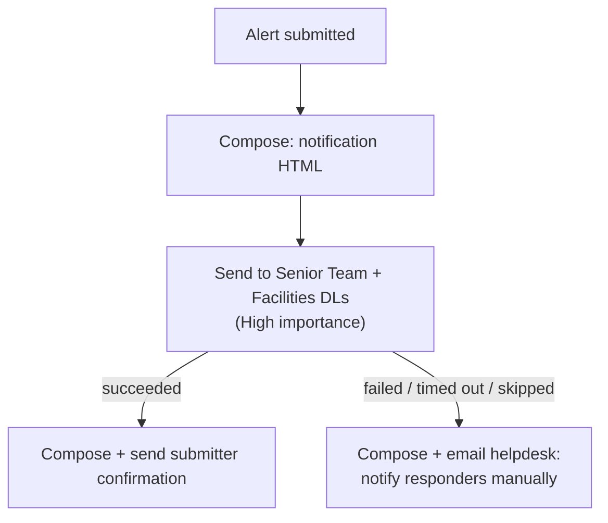

# Emergency Alert System: Responder Notification

When a staff member submits an emergency alert (medical, smoke, suspicious person), this flow notifies the senior team and facilities within the polling window. It confirms to the submitter only after the notification actually went out, and it escalates to a monitored mailbox if the notification fails.

**Connectors:** SharePoint · Office 365 Outlook  
**Trigger:** new item on the *Emergency Alerts* list (intranet form)  
**Size:** 6 actions. It's small on purpose: every action is on the critical path.

## The problem

A review of the original flow's JSON found:

- **The Alert Type rendered as literal text** in the email, because the expression wrapper was missing.
- **Recipients were chosen with Get my profile,** which reflects the flow's connection, not the person who submitted.
- **Timestamps were in raw UTC.**
- **The subject line was uninformative.**
- **There was no confirmation to the submitter and no failure path.** If the email failed, nobody would know responders weren't notified.

## What it does

1. **Builds the notification** in a Compose: alert type, location, description, who submitted it, and when (converted to Eastern time).
2. **Sends it** to two mail-enabled distribution groups (senior team and facilities) with **High** importance.
3. **Confirms to the submitter, only if step 2 succeeded.** The confirmation says responders were notified and reminds them to call 911 for life-threatening emergencies.
4. **Handles failure.** If step 2 *fails, times out or is skipped*, a parallel branch emails a monitored helpdesk mailbox, telling them to contact responders manually, with every detail and a link to the run.

## Architecture



## Key design decisions

| Decision | Why |
|---|---|
| **The confirmation comes after the notification,** not before | The submitter must never be told responders were notified when they weren't. The failure branch covers that case instead. |
| **Email HTML is built in Compose actions** | The email body field's rich-text editor (Lexical) can't round-trip tables or styled `div`s. Once complex HTML is pasted, the code-view toggle locks, and nested quotes in `@{}` expressions fail validation. Compose has a plain expression field, and the email body gets a single token. |
| **Two distribution groups,** no routing table | Every alert goes to the same responders. Group membership is maintained in Exchange, not in the flow. |
| **The system Author field,** not a "Submitted by" form field | The manual field was redundant and could be wrong, so it was removed from the form. Accounts aren't shared, so Author is reliable. |
| **`coalesce()` on every field** | A blank optional field shows "Not specified" instead of breaking the email. |

## Lessons from the build

- **"Succeeded" means Exchange accepted the message, not that it was delivered.** Testing the failure path with an invalid address doesn't work: the send still succeeds, and the bounce happens later, outside the flow. To exercise the failure branch, temporarily force an empty recipient (`coalesce(null, '')`), then revert and run a normal test.
- **`result()` is documented for scopes.** Pointing it at a single action to get the error text is unreliable, so the failure email links to the run instead. Wrapping the send in a Scope is the path if the error text is ever needed inline.
- **One minute is the floor for SharePoint polling triggers.** The thing to watch is whether licensing stretches that interval. Gaps between runs in run history will show it.

## Configuration

| Environment variable | Purpose |
|---|---|
| `plb_AlertsSiteUrl`, `plb_EmergencyAlertsList` | Site and list |
| `plb_SeniorTeamDL`, `plb_FacilitiesDL` | Responder distribution groups |
| `plb_HelpdeskEmail` | Monitored mailbox for delivery failures |

**List columns used:** Alert Type (choice, internal `Alert_x0020_Type`), Location (choice), BriefDescription, plus the system fields Created By and Created.

## Action outline

<details>
<summary>Expand the full action tree</summary>

<!-- outline:start -->
```text
When_an_item_is_created · SharePoint: when an item is created
├─ Build_Email_Body · Compose
├─ Send_Emergency_Notification · Outlook: Send an email (V2)
├─ Build_Confirmation_Body · Compose
├─ Send_Submitter_Confirmation · Outlook: Send an email (V2)
├─ Build_Failure_Body · Compose  (runs after Send_Emergency_Notification [Failed/TimedOut/Skipped])
└─ Notify_On_Failure · Outlook: Send an email (V2)
```
<!-- outline:end -->

</details>

## Reconstruction notes

- **The subject format** (`EMERGENCY ALERT: {type} - {location}`) and **the run link** in the failure email are representative of the rebuilt flow.
