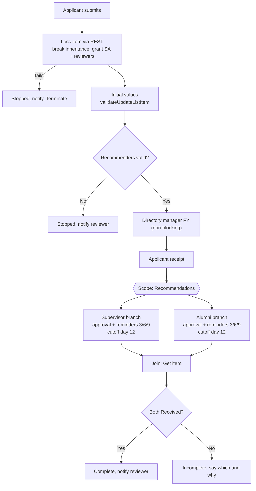

# Emerging Leaders Program: Confidential Application and Recommendations

Takes an application to a leadership development program and locks it within seconds so only the program's reviewers can see it. It then collects two confidential recommendations in parallel, one from the applicant's supervisor and one from a program alum. Each recommender gets their own reminders and cutoff, and every write-back is checked.

**Connectors:** SharePoint (including REST) · Approvals · Office 365 Users · Office 365 Outlook  
**Trigger:** new item on the *Emerging Leaders Application* list  
**Size:** 104 actions, the largest flow here

## The problem

The program ran on a PDF form, with recommendations gathered by email. Moving it to SharePoint raised a confidentiality problem the usual list setup doesn't solve:

- **Applicants shouldn't see their recommendations,** and nobody should see anyone else's application.
- **Recommenders shouldn't need access to the list at all.**
- **One slow recommender shouldn't hold up or lose the other's response.**

## What it does

1. **Locks the item.** Three SharePoint REST calls run inside a scope:
   - Break role inheritance and clear every existing assignment.
   - Grant the service account Full Control, so later write-backs can't be locked out.
   - Grant the *ELP Reviewers* group Edit.

   If the lock fails, the application is set to **Stopped**, the reviewer and IT are emailed, and the flow ends *before any recommendation request goes out*.
2. **Sets initial values** through `validateUpdateListItem`, and checks the response for field errors.
3. **Validates the recommenders.** It stops and tells the reviewer if the applicant named themselves, or named the same person for both roles.
4. **Checks the supervisor.** If the named supervisor isn't the applicant's manager in the directory, the reviewer gets an FYI and the flow continues.
5. **Confirms receipt.** It emails the applicant, naming both recommenders and explaining that the application can't be viewed or edited after submitting.
6. **Runs two parallel branches,** one per recommender, in a parent scope. Each branch:
   - Creates a single-response approval (*Submit recommendation*) whose card carries everything the recommender needs. There's no item link, because the recommender has no access to the item.
   - Waits in 3-day increments, with reminders on days 3, 6 and 9 (the reviewer is CC'd on day 9) and a cutoff on day 12.
   - Writes the recommendation, date and status back to the locked item, and fails loudly if SharePoint reports a field error.
   - Flags blank comments to the reviewer.
   - On a branch failure, such as a disabled recommender account, sets that branch's status to **Error** without affecting the other branch.
7. **Joins the branches.** The join runs no matter how the branches ended. It sets **Complete** if both recommendations were received, and otherwise **Incomplete**, telling the reviewer which recommendation is missing and why.

## Architecture



## Key design decisions

| Decision | Why |
|---|---|
| **Break permissions per item** right after submission | Applicants don't revisit applications, so removing their access costs nothing and guarantees confidentiality. List-level "read/edit only your own items" covers the few seconds before the lock. |
| **Grant the service account Full Control explicitly** | After inheritance is broken, the flow's own later write-backs would otherwise be denied. |
| **Two approvals in parallel scopes**, with separate variables per branch | Each recommender has an independent clock. Parallel branches never write to the same variable. |
| **`validateUpdateListItem` through Send an HTTP request** | It updates only the flow's columns, without resending the applicant's required fields. The body is built in a Compose typed as an object, so quotes, apostrophes and line breaks in recommendations are escaped correctly. |
| **Check `HasException`, not the status code** | `validateUpdateListItem` returns HTTP 200 even when a field fails, and reports the failure per field. |
| **No item link on the card, and no recommendation text in emails** | Recommenders would hit access denied, and emails would spread confidential text. Reviewer emails link to the locked item instead. |
| **Secure inputs and outputs** on the wait, comment variables, write-back Compose and HTTP actions | Run history otherwise shows recommendation text to anyone who can see the flow's runs. |
| **The join always runs** (after Succeeded, Failed or TimedOut) | A timed-out or failed branch makes the application Incomplete. It never stops the other branch or skips the final status. |
| **The reviewer address lives in one variable** | Moving to a shared mailbox is a one-field change. Emails send as the program's shared mailbox. |

## Lessons from the build

An export review against the build spec before go-live found these issues:

- **The wait counter was attached to the wrong action.** The alumni branch's increment was set to run after *Set variable: TimedOut* instead of *Wait for an approval: TimedOut*. A Set variable action can't time out, so reminders and the cutoff would never have fired. This repo's [`validate_definitions.py`](../../scripts/validate_definitions.py) now flags any branch that waits on a timeout from an action that can't time out.
- **One approval allowed reassignment and the other didn't.** Both are now off, so the recommendation comes from the person who was named.
- **One write-back HTTP action was missing its OData headers.**
- **Comment variables weren't secured,** even though the spec called for it.
- **Testing timeouts (`PT5M`) were still in place.** The rule is to restore production values only after the retest.
- **The reviewer's address was typed into five emails** instead of using the variable, which would have broken the one-field handoff.
- **Long column names get truncated.** SharePoint cuts internal names at 32 characters, so every internal name was looked up rather than guessed.

## Testing checklist (abridged)

- A non-admin test applicant loses access within seconds of submitting, and can't find other applications through search.
- A reviewer can open and edit the locked item, and the service account can still write back.
- Both recommenders respond → Complete. One doesn't → reminders, cutoff and Incomplete.
- Quotes, apostrophes and line breaks in a recommendation write back intact.
- Self-named and same-person submissions are stopped. A disabled recommender produces Error, then Incomplete.
- A forced lock failure (wrong group ID) stops the flow with no approvals sent.
- Run history shows secured values.

## Configuration

| Environment variable | Purpose |
|---|---|
| `plb_TalentSiteUrl`, `plb_ElpApplicationList` | Site and list |
| `plb_ElpReviewersGroupId` | SharePoint group ID for reviewers |
| `plb_ServiceAccountUserId` | SharePoint user ID of the service account |
| `plb_SpFullControlRoleId`, `plb_SpEditRoleId` | Role definition IDs (SharePoint defaults are `1073741829` and `1073741830`; confirm them on the site) |
| `plb_ElpReviewerEmail` | Program owner who receives reviewer emails |
| `plb_ElpSenderMailbox` | Shared mailbox the flow sends as (the service account needs Send As) |
| `plb_TechOpsEmail` | IT alerts |

**List columns:** applicant questions (Interest, HopeToGain, ApplyLearning, CommitteeService), Position, StartDate, Supervisor and ProgramAlumni (person), and flow-managed columns hidden from the form: Supervisor/Alumni Recommendation, Rec Date and Status (`Pending`, `Received`, `Timed Out`, `Error`), plus Application Status (`Submitted`, `Awaiting Recommendations`, `Complete`, `Incomplete`, `Stopped`).

## Action outline

<details>
<summary>Expand the full action tree (variables omitted)</summary>

<!-- outline:start -->
```text
When_an_item_is_created · SharePoint: when an item is created
├─ Scope_Try · Scope
│  ├─ Scope_Lock_item · Scope
│  │  ├─ HTTP_Break_Inheritance · SharePoint: Send an HTTP request
│  │  ├─ HTTP_Grant_Service_Account · SharePoint: Send an HTTP request
│  │  └─ HTTP_Grant_Reviewers · SharePoint: Send an HTTP request
│  ├─ Compose_Stopped_Lock_Values · Compose  (runs after Scope_Lock_item [Failed/TimedOut])
│  ├─ HTTP_Set_Stopped_Lock · SharePoint: Send an HTTP request
│  ├─ Email_Lock_Failed · Outlook: Send an email (V2)  (runs after HTTP_Set_Stopped_Lock [Succeeded/Failed])
│  ├─ Terminate_Lock_Failed · Terminate  (runs after Email_Lock_Failed [Succeeded/Failed]; Failed)
│  ├─ Compose_Initial_Values · Compose
│  ├─ HTTP_Set_Initial_Values · SharePoint: Send an HTTP request
│  ├─ Condition_Initial_Values_Failed · Condition
│  │  └─ If yes
│  │     ├─ Email_Initial_Values_Failed · Outlook: Send an email (V2)
│  │     └─ Terminate_Initial_Values_Failed · Terminate  (runs after Email_Initial_Values_Failed [Succeeded/Failed]; Failed)
│  ├─ Condition_Recommenders_Invalid · Condition
│  │  └─ If yes
│  │     ├─ Compose_Invalid_Reason · Compose
│  │     ├─ Compose_Stopped_Values · Compose
│  │     ├─ HTTP_Set_Stopped_Invalid · SharePoint: Send an HTTP request
│  │     ├─ Email_Recommenders_Invalid · Outlook: Send an email (V2)  (runs after HTTP_Set_Stopped_Invalid [Succeeded/Failed])
│  │     └─ Terminate_Recommenders_Invalid · Terminate  (runs after Email_Recommenders_Invalid [Succeeded/Failed]; Succeeded)
│  ├─ Get_Applicant_Manager · Office 365 Users: Get manager (V2)
│  ├─ Condition_Manager_Mismatch · Condition  (runs after Get_Applicant_Manager [Succeeded/Failed])
│  │  └─ If yes
│  │     └─ Email_Manager_Mismatch · Outlook: Send an email (V2)
│  ├─ Email_Applicant_Received · Outlook: Send an email (V2)  (runs after Condition_Manager_Mismatch [Succeeded/Failed])
│  ├─ Scope_Recommendations · Scope  (runs after Email_Applicant_Received [Succeeded/Failed])
│  │  ├─ Scope_Supervisor · Scope
│  │  │  ├─ Create_Approval_Supervisor · Approvals: Create an approval
│  │  │  ├─ Do_Until_Sup_Responded · Do until  (count 10, timeout P15D)
│  │  │  │  ├─ Wait_Approval_Supervisor · Approvals: Wait for an approval  (timeout P3D; secured)
│  │  │  │  ├─ Set_varSupComments · Set variable  (secured)
│  │  │  │  ├─ Set_varSupOutcome · Set variable
│  │  │  │  ├─ Set_varSupDate · Set variable
│  │  │  │  ├─ Set_varSupResponded · Set variable
│  │  │  │  ├─ Increment_varSupWaits · Increment variable  (runs after Wait_Approval_Supervisor [TimedOut])
│  │  │  │  └─ Condition_Sup_Send_Reminder · Condition
│  │  │  │     └─ If yes
│  │  │  │        └─ Email_Sup_Reminder · Outlook: Send an email (V2)
│  │  │  └─ Condition_Sup_Responded · Condition  (runs after Do_Until_Sup_Responded [Succeeded/Failed/TimedOut])
│  │  │     ├─ If yes
│  │  │     │  ├─ Compose_Sup_Received_Values · Compose  (secured)
│  │  │     │  ├─ HTTP_Set_Sup_Received · SharePoint: Send an HTTP request  (secured)
│  │  │     │  ├─ Condition_Sup_Write_Failed · Condition
│  │  │     │  │  └─ If yes
│  │  │     │  │     └─ Email_Sup_Write_Failed · Outlook: Send an email (V2)
│  │  │     │  └─ Condition_Sup_Blank_Comments · Condition
│  │  │     │     └─ If yes
│  │  │     │        └─ Email_Sup_Blank · Outlook: Send an email (V2)
│  │  │     └─ If no
│  │  │        ├─ Compose_Sup_Timed_Out_Values · Compose
│  │  │        ├─ HTTP_Set_Sup_Timed_Out · SharePoint: Send an HTTP request
│  │  │        └─ Email_Sup_Timed_Out · Outlook: Send an email (V2)  (runs after HTTP_Set_Sup_Timed_Out [Succeeded/Failed])
│  │  ├─ Condition_Sup_Scope_Failed · Condition  (runs after Scope_Supervisor [Succeeded/Failed/TimedOut/Skipped])
│  │  │  └─ If yes
│  │  │     ├─ Compose_Sup_Error_Values · Compose
│  │  │     ├─ HTTP_Set_Sup_Error · SharePoint: Send an HTTP request
│  │  │     └─ Email_Sup_Error · Outlook: Send an email (V2)  (runs after HTTP_Set_Sup_Error [Succeeded/Failed])
│  │  ├─ Scope_Alumni · Scope
│  │  │  ├─ Create_Approval_Alumni · Approvals: Create an approval
│  │  │  ├─ Do_Until_Alum_Responded · Do until  (count 10, timeout P15D)
│  │  │  │  ├─ Wait_Approval_Alumni · Approvals: Wait for an approval  (timeout P3D; secured)
│  │  │  │  ├─ Set_varAlumComments · Set variable  (secured)
│  │  │  │  ├─ Set_varAlumOutcome · Set variable
│  │  │  │  ├─ Set_varAlumDate · Set variable
│  │  │  │  ├─ Set_varAlumResponded · Set variable
│  │  │  │  ├─ Increment_varAlumWaits · Increment variable  (runs after Wait_Approval_Alumni [TimedOut])
│  │  │  │  └─ Condition_Alum_Send_Reminder · Condition
│  │  │  │     └─ If yes
│  │  │  │        └─ Email_Alum_Reminder · Outlook: Send an email (V2)
│  │  │  └─ Condition_Alum_Responded · Condition  (runs after Do_Until_Alum_Responded [Succeeded/Failed/TimedOut])
│  │  │     ├─ If yes
│  │  │     │  ├─ Compose_Alum_Received_Values · Compose  (secured)
│  │  │     │  ├─ HTTP_Set_Alum_Received · SharePoint: Send an HTTP request  (secured)
│  │  │     │  ├─ Condition_Alum_Write_Failed · Condition
│  │  │     │  │  └─ If yes
│  │  │     │  │     └─ Email_Alum_Write_Failed · Outlook: Send an email (V2)
│  │  │     │  └─ Condition_Alum_Blank_Comments · Condition
│  │  │     │     └─ If yes
│  │  │     │        └─ Email_Alum_Blank · Outlook: Send an email (V2)
│  │  │     └─ If no
│  │  │        ├─ Compose_Alum_Timed_Out_Values · Compose
│  │  │        ├─ HTTP_Set_Alum_Timed_Out · SharePoint: Send an HTTP request
│  │  │        └─ Email_Alum_Timed_Out · Outlook: Send an email (V2)  (runs after HTTP_Set_Alum_Timed_Out [Succeeded/Failed])
│  │  └─ Condition_Alum_Scope_Failed · Condition  (runs after Scope_Alumni [Succeeded/Failed/TimedOut/Skipped])
│  │     └─ If yes
│  │        ├─ Compose_Alum_Error_Values · Compose
│  │        ├─ HTTP_Set_Alum_Error · SharePoint: Send an HTTP request
│  │        └─ Email_Alum_Error · Outlook: Send an email (V2)  (runs after HTTP_Set_Alum_Error [Succeeded/Failed])
│  ├─ Get_Item_Final_Status · SharePoint: Get item  (runs after Scope_Recommendations [Succeeded/Failed/TimedOut])
│  └─ Condition_Both_Received · Condition
│     ├─ If yes
│     │  ├─ Compose_Complete_Values · Compose
│     │  ├─ HTTP_Set_Complete · SharePoint: Send an HTTP request
│     │  └─ Email_Complete_Reviewer · Outlook: Send an email (V2)  (runs after HTTP_Set_Complete [Succeeded/Failed])
│     └─ If no
│        ├─ Compose_Incomplete_Values · Compose
│        ├─ HTTP_Set_Incomplete · SharePoint: Send an HTTP request
│        └─ Email_Incomplete_Reviewer · Outlook: Send an email (V2)  (runs after HTTP_Set_Incomplete [Succeeded/Failed])
└─ Scope_Catch · Scope  (runs after Scope_Try [Failed/TimedOut])
   ├─ Email_Flow_Error · Outlook: Send an email (V2)
   └─ Terminate_Flow_Error · Terminate  (runs after Email_Flow_Error [Succeeded/Failed]; Failed)
```
<!-- outline:end -->

</details>

## Reconstruction notes

- **Names and wording:** the program name, question text and column names are generalized.
- **Item addressing:** REST calls use the list's GUID through an environment variable. Production addressed the list by title.
- **Business-owner decisions** are reflected as built: comments only (no rating), no "recommendations are in" email to the applicant, a single reviewer, and rolling 12-day windows.
