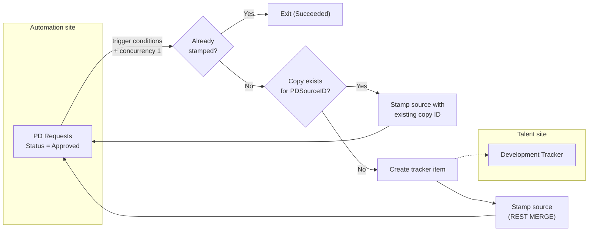

# PD Approvals: Copy Approved Requests to the Development Tracker

A one-way copy that pushes each approved professional development request into the Talent Development team's tracker on another site. It's idempotent, safe to re-run, and never gives the business team access to the IT automation site.

**Connectors:** SharePoint · Office 365 Outlook  
**Trigger:** item created or modified on *Professional Development Requests*, gated by trigger conditions and concurrency 1  
**Size:** 16 actions

## The problem

The Talent team's Development Tracker is their system of record, and it also receives two other intake forms. Rebuilding the approval process on that list would have meant three forms feeding one list with the team's required fields, so the approval data stays on the IT automation site.

The Talent team still needed approved requests in their own list. They shouldn't need access to the automation site to get them, and two-way sync wasn't a reasonable option.

## What it does

1. **Fires only on approval.** The trigger conditions require Status = `Approved` and `TrackerCopied` ≠ true. Concurrency is set to 1, so modifications queue instead of racing each other.
2. **Rechecks the item.** It re-reads the item and exits if another run already stamped it.
3. **Builds the tracker fields.**
   - The requester goes into a person-array field.
   - Provider values are mapped to the tracker's choices.
   - A summary comment is built with costs and decision dates.
   - Tracker fields that have no source value get the placeholder `Needs Update`, for the Talent team to fill in.
4. **Checks for an existing copy.** It looks up the target list by `PDSourceID`.
   - If a copy exists, it links to that copy instead of creating a duplicate.
   - Otherwise it creates the tracker item.
5. **Stamps the source.** It sets `TrackerCopied` and `TrackerItemId` on the source item with a REST `MERGE`.
6. **Handles failures.** Catch emails both IT and the Talent team and ends the run as *Failed* (code `CopyFailed`).

## Architecture



## Key design decisions

| Decision | Why |
|---|---|
| **Push copy by the service account** | The Talent team never needs permissions on the automation site. Their list stays theirs. |
| **Three layers of idempotency:** trigger conditions, concurrency 1 with a recheck, and a duplicate check on `PDSourceID` | Edits in two polling windows can't double-copy. If the stamp fails after the create, the next run links to the existing copy instead of creating a duplicate. |
| **REST `MERGE` for the stamp**, not Update item | Update item has to resend every required field. `MERGE` writes only the two tracking columns. Addressing the list by GUID means renaming the list can't break the flow. |
| **A point-in-time snapshot** | Edits, cancellations or denials on the source after the copy don't carry over. The Talent team owns the record from then on, and this was agreed with them up front. |
| **A `Needs Update` placeholder** for required fields with no source | The Talent team filters a view on it to see which copied records still need their input. |
| **`Auto-Approved` kept in the trigger condition** | Older records still carry that legacy value. Keeping it costs nothing. |

## Lessons from the build

An export review before go-live caught three bugs that would have failed the first real run:

- **`item()` outside a loop.** `item()` only works inside Apply to each. The source-ID mapping used it with no loop around it, so Create item would have failed every time, and a blank ID would have defeated the duplicate check. The fix was `triggerBody()?['ID']`.
- **A stray comma in the REST URI.** It produced `items(, 142 )`, which SharePoint rejects. The URI was rebuilt with the list GUID while fixing it.
- **Multi-select fields need arrays.** MultiChoice columns take `[{"Value": "..."}]`, not a plain string. The fix was to switch the field to array-item input in the designer.

## Testing approach

No fake data was needed. Each test reset `TrackerCopied` to No on a record that was already approved:

1. **Copy works.** One run fires, the record appears in the tracker, and the source is stamped.
2. **No duplicates.** Harmless edits on the same record start no new run.
3. **Failures are caught.** A temporary `div(1,0)` Compose sends the failure email, the run shows *Failed*, and nothing lands in the tracker. A retry after removing it succeeds.

## Configuration

| Environment variable | Purpose |
|---|---|
| `plb_AutomationSiteUrl`, `plb_PDRequestsList` | Source site and list |
| `plb_TalentSiteUrl`, `plb_DevTrackerList` | Target site and list |
| `plb_TechOpsEmail`, `plb_TalentTeamEmail` | Failure alert recipients |

**Target columns:** Title, TrainingHoursPerEmployee, AdditionalExpensePerEmployee, StartDate, EndDate, EmployeesTrained (person, multi), Provider, EducationType, Executive (multi-choice), Department (multi-choice), IsThisForAnIDP, CommentSection, ManagerApprovalComments, SeniorLeaderApprovalComments, Source, PDSourceID.

## Action outline

<details>
<summary>Expand the full action tree</summary>

<!-- outline:start -->
```text
When_an_item_is_created_or_modified · SharePoint: when an item is created or modified  (2 trigger condition(s); concurrency 1)
├─ Try · Scope
│  ├─ Get_item_-_Recheck · SharePoint: Get item
│  ├─ Condition_-_Already_copied · Condition
│  │  └─ If yes
│  │     └─ Terminate_-_Already_copied · Terminate  (Succeeded)
│  ├─ Compose_-_Placeholder · Compose
│  ├─ Compose_-_EmployeesTrained · Compose
│  ├─ Compose_-_TrackerProvider · Compose
│  ├─ Compose_-_TrackerComment · Compose
│  ├─ Get_items_-_Existing_tracker_copy · SharePoint: Get items
│  └─ Condition_-_Tracker_copy_exists · Condition
│     ├─ If yes
│     │  └─ Stamp_source_-_Existing_copy · SharePoint: Send an HTTP request (MERGE)
│     └─ If no
│        ├─ Create_item_-_Development_Tracker · SharePoint: Create item
│        └─ Stamp_source_-_Copied · SharePoint: Send an HTTP request (MERGE)
└─ Catch · Scope  (runs after Try [Failed/TimedOut])
   ├─ Send_copy_failure_alert · Outlook: Send an email (V2)
   └─ Terminate_-_Copy_failed · Terminate  (runs after Send_copy_failure_alert [Succeeded/Failed]; Failed)
```
<!-- outline:end -->

</details>

## Reconstruction notes

- **Provider names** in the mapping (`CU League`, `Payments Association`, `Core Processor`) are placeholders for the real vendor list.
- **The target list's column names** are made readable here. Production used the target list's auto-generated internal names (`field_7`, `field_11`, and so on).
