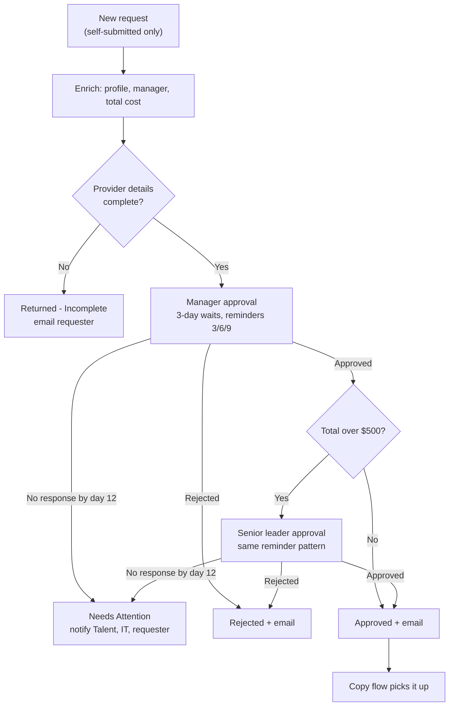

# Professional Development Approvals: Intake and Approval Routing

Routes employee requests for training and conferences through manager approval, and adds senior leader approval when the cost is over $500. Every stage sends reminders, expires cleanly, and keeps failures out of the employee's way.

**Connectors:** SharePoint · Approvals · Office 365 Users · Office 365 Outlook  
**Trigger:** new item on the *Professional Development Requests* list  
**Size:** 65 actions

## The problem

The first version used **Start and wait for an approval**. When an approver didn't respond, nothing happened for 30 days. Then the action timed out, the run failed into the error handler, and IT got an alert for what was really a business problem: nobody had answered. Meanwhile the employee had been waiting a month.

Two other issues showed up in production:

- **Records entered on someone's behalf fired approvals.** The Talent Development team enters some records for employees. Those were never meant to route.
- **Stale manager data broke routing.** Approvals went to a departed manager whose account was disabled but still listed in AD. That led to a separate fix, the [Disabled Manager Report](../disabled-manager-report/).

## What it does

1. **Filters at the trigger.** The flow fires only for self-submitted requests. The `Requester` column is filled in by the flow itself, so it's blank on a self-submission. Records the Talent team enters for someone else already have a Requester, so they never start a run.
2. **Enriches the request.** It looks up the requester's department, job title and manager, totals program plus travel cost, and writes all of it back to the item.
3. **Checks provider details.** A request with provider "Other" and no provider name is returned to the requester instead of being routed.
4. **Manager stage.** Creates the approval, then waits in 3-day increments:
   - **Days 3, 6 and 9:** a reminder to the approver. The Talent team is CC'd from the second reminder on.
   - **Day 12:** the request is set to **Needs Attention**, the Talent team, IT and the requester are notified, and the run ends as *Succeeded*.
5. **Threshold.** If the cost is $500 or less, manager approval is final. If it's over $500, the request goes to a **senior leader stage** built the same way.
6. **Outcome.** The flow writes the status, decision comments and decision dates to the item, then emails the requester with the Talent team CC'd. When the status becomes `Approved`, the [copy flow](../pd-approvals-copy-to-tracker/) picks the request up.

The worst case is 12 days per stage, 24 days in total, which stays under Power Automate's 30-day run limit.

## Architecture



## Key design decisions

| Decision | Why |
|---|---|
| **Create an approval** plus a **Do until** loop of **Wait for an approval**, instead of Start and wait | Reminders need the approval ID while the approval is still open. One approval is created and waited on repeatedly, so the approver sees a single request, not one per reminder. |
| Decision values saved to **variables** (`MgrOutcome`, `MgrComments`, `MgrDate`) | Downstream actions reference variables instead of reaching into the loop. An earlier plan renamed the new Wait action to the old action's name, which is fragile. |
| Increment runs after **Succeeded or TimedOut only** | Leaving *Failed* unchecked means a real error, such as a bad approval ID, still goes to Catch instead of being treated as "no response yet." |
| Expiry ends with **Terminate: Succeeded** | No response is a business outcome. Terminate defaults to *Failed*, which would turn every expiry into a false IT alert. |
| **No auto-approve and no auto-reject** at expiry | A person decides. The Talent team follows up on anything marked Needs Attention. |
| **Calendar days** for reminders | Skipping weekends adds real complexity for little gain at a 3-day cadence. |
| **Try / Catch** around the main path | Any unexpected failure sets the request to **Routing Error** and emails IT the error message and a direct link to the run. |

## Lessons from the build

- **Do until's default timeout is one hour (`PT1H`).** Without raising it to `P14D`, the loop would end an hour into a 12-day wait.
- **A typo in an ISO 8601 duration** (`P140` instead of `P14D`) passed the designer and failed only at runtime.
- **Leftover expressions pointing at deleted actions** didn't show up in Flow Checker. They turned up by searching Code view. That bug class is why this repo runs [`validate_definitions.py`](../../scripts/validate_definitions.py) in CI.
- **Two flows writing to the same item** produced a save conflict during testing. Running a test copy next to the live flow needs a guard so they never touch the same items (here, a `TEST-` title prefix in the trigger condition).
- **Re-running stuck requests without breaking them.** After cutover, 10 requests from the old flow were stuck waiting. Cloning them would have changed *Created By*, which the flow uses to find the manager, so approvals would have gone to the service account's manager. The fix was a temporary copy of the flow with a *created or modified* trigger, gated on a `Resubmit` status. Swapping the trigger in the designer orphaned 83 downstream references. Changing one `operationId` in the exported JSON (`GetOnNewItems` → `GetOnUpdatedItems`) kept every reference intact.
- **Late responses after expiry go nowhere.** The approval stays open in the approver's inbox, but a response no longer updates anything. The expiry email says so.

## Testing approach

Changes were built in a copy of the live flow, with both 3-day waits shortened to `PT5M`, then cut over. These scenarios were tested:

1. The manager responds on the first wait.
2. The manager never responds: three reminders, Talent CC'd from the second one, expiry, and the run ends *Succeeded*.
3. Over $500, the manager approves and the senior leader never responds: the same expiry path on stage two.
4. A response after expiry is confirmed to change nothing.

## Configuration

| Environment variable | Purpose |
|---|---|
| `plb_AutomationSiteUrl` | Site that hosts the request list |
| `plb_PDRequestsList` | Request list ID (GUID) |
| `plb_TalentTeamEmail` | Talent team mailbox (CC on reminders, expiry, decisions) |
| `plb_TechOpsEmail` | IT mailbox for expiry notices and failures |

**Connection references:** SharePoint, Approvals, Office 365 Users and Outlook, all owned by the automation service account (see [ALM notes](../../docs/alm.md)).

**List columns used:** Title, Requester (person), Department, JobTitle, Manager (person), SeniorLeader (person), Provider (choice), VendorName, Description, ProgramCost, TravelCost, TotalCost, TotalHours, ProgramStart, ProgramEnd, Status (choice), ManagerComments, ManagerDecisionDate, SLComments, SLDecisionDate, TrackerCopied, TrackerItemId.

**Status values:** Pending Manager Approval · Pending Senior Leader Approval · Approved · Rejected · Needs Attention · Returned - Incomplete · Routing Error

## Action outline

<details>
<summary>Expand the full action tree</summary>

<!-- outline:start -->
```text
When_an_item_is_created · SharePoint: when an item is created  (1 trigger condition(s))
├─ Initialize_MgrOutcome · Initialize variable
├─ Initialize_MgrComments · Initialize variable
├─ Initialize_MgrDate · Initialize variable
├─ Initialize_MgrWaits · Initialize variable
├─ Initialize_SLOutcome · Initialize variable
├─ Initialize_SLComments · Initialize variable
├─ Initialize_SLDate · Initialize variable
├─ Initialize_SLWaits · Initialize variable
├─ Try · Scope
│  ├─ Get_user_profile_(V2) · Office 365 Users: Get user profile (V2)
│  ├─ Get_manager_(V2) · Office 365 Users: Get manager (V2)
│  ├─ Compose_-_TotalCost · Compose
│  ├─ Update_item_-_Requester_details · SharePoint: Update item
│  ├─ Condition_-_Provider_details_missing · Condition
│  │  └─ If yes
│  │     ├─ Update_item_-_Returned_incomplete · SharePoint: Update item
│  │     ├─ Send_incomplete_email_to_requester · Outlook: Send an email (V2)  (runs after Update_item_-_Returned_incomplete [Succeeded/Failed])
│  │     └─ Terminate_-_Returned_incomplete · Terminate  (runs after Send_incomplete_email_to_requester [Succeeded/Failed]; Cancelled)
│  ├─ Update_item_-_Pending_Manager_Approval · SharePoint: Update item
│  ├─ Create_Mgr_Approval · Approvals: Create an approval
│  ├─ Mgr_Wait_Loop · Do until  (count 6, timeout P14D)
│  │  ├─ Wait_Mgr_Approval · Approvals: Wait for an approval  (timeout P3D)
│  │  ├─ Increment_MgrWaits · Increment variable  (runs after Wait_Mgr_Approval [Succeeded/TimedOut])
│  │  └─ Mgr_Pending · Condition
│  │     ├─ If yes
│  │     │  └─ Condition_-_Mgr_send_reminder · Condition
│  │     │     └─ If yes
│  │     │        └─ Send_Mgr_reminder · Outlook: Send an email (V2)
│  │     └─ If no
│  │        ├─ Set_MgrOutcome · Set variable
│  │        ├─ Set_MgrComments · Set variable
│  │        └─ Set_MgrDate · Set variable
│  ├─ Mgr_Expired · Condition
│  │  └─ If yes
│  │     ├─ Update_item_-_Mgr_expired · SharePoint: Update item
│  │     ├─ Send_Mgr_expiry_to_Talent_and_IT · Outlook: Send an email (V2)  (runs after Update_item_-_Mgr_expired [Succeeded/Failed])
│  │     ├─ Send_Mgr_expiry_to_requester · Outlook: Send an email (V2)  (runs after Send_Mgr_expiry_to_Talent_and_IT [Succeeded/Failed])
│  │     └─ Terminate_-_Mgr_expired · Terminate  (runs after Send_Mgr_expiry_to_requester [Succeeded/Failed]; Succeeded)
│  └─ Condition_-_Manager_outcome · Condition
│     ├─ If yes
│     │  └─ Condition_-_Over_500 · Condition
│     │     ├─ If yes
│     │     │  ├─ Update_item_-_Pending_Senior_Leader_Approval · SharePoint: Update item
│     │     │  ├─ Create_SL_Approval · Approvals: Create an approval
│     │     │  ├─ SL_Wait_Loop · Do until  (count 6, timeout P14D)
│     │     │  │  ├─ Wait_SL_Approval · Approvals: Wait for an approval  (timeout P3D)
│     │     │  │  ├─ Increment_SLWaits · Increment variable  (runs after Wait_SL_Approval [Succeeded/TimedOut])
│     │     │  │  └─ SL_Pending · Condition
│     │     │  │     ├─ If yes
│     │     │  │     │  └─ Condition_-_SL_send_reminder · Condition
│     │     │  │     │     └─ If yes
│     │     │  │     │        └─ Send_SL_reminder · Outlook: Send an email (V2)
│     │     │  │     └─ If no
│     │     │  │        ├─ Set_SLOutcome · Set variable
│     │     │  │        ├─ Set_SLComments · Set variable
│     │     │  │        └─ Set_SLDate · Set variable
│     │     │  ├─ SL_Expired · Condition
│     │     │  │  └─ If yes
│     │     │  │     ├─ Update_item_-_SL_expired · SharePoint: Update item
│     │     │  │     ├─ Send_SL_expiry_to_Talent_and_IT · Outlook: Send an email (V2)  (runs after Update_item_-_SL_expired [Succeeded/Failed])
│     │     │  │     ├─ Send_SL_expiry_to_requester · Outlook: Send an email (V2)  (runs after Send_SL_expiry_to_Talent_and_IT [Succeeded/Failed])
│     │     │  │     └─ Terminate_-_SL_expired · Terminate  (runs after Send_SL_expiry_to_requester [Succeeded/Failed]; Succeeded)
│     │     │  └─ Condition_-_SL_outcome · Condition
│     │     │     ├─ If yes
│     │     │     │  ├─ Update_item_-_SL_Approved · SharePoint: Update item
│     │     │     │  └─ Send_approved_email_-_SL · Outlook: Send an email (V2)  (runs after Update_item_-_SL_Approved [Succeeded/Failed])
│     │     │     └─ If no
│     │     │        ├─ Update_item_-_SL_Rejected · SharePoint: Update item
│     │     │        └─ Send_rejected_email_-_SL · Outlook: Send an email (V2)  (runs after Update_item_-_SL_Rejected [Succeeded/Failed])
│     │     └─ If no
│     │        ├─ Update_item_-_Approved_(manager_only) · SharePoint: Update item
│     │        └─ Send_approved_email_-_Manager · Outlook: Send an email (V2)  (runs after Update_item_-_Approved_(manager_only) [Succeeded/Failed])
│     └─ If no
│        ├─ Update_item_-_Manager_Rejected · SharePoint: Update item
│        └─ Send_rejected_email_-_Manager · Outlook: Send an email (V2)  (runs after Update_item_-_Manager_Rejected [Succeeded/Failed])
└─ Catch · Scope  (runs after Try [Failed/TimedOut])
   ├─ Filter_array_-_Failed_actions · Filter array
   ├─ Update_item_-_Routing_Error · SharePoint: Update item
   ├─ Send_IT_failure_alert · Outlook: Send an email (V2)  (runs after Update_item_-_Routing_Error [Succeeded/Failed])
   └─ Terminate_-_Failed · Terminate  (runs after Send_IT_failure_alert [Succeeded/Failed]; Failed)
```
<!-- outline:end -->

</details>

## Reconstruction notes

This definition was rebuilt from the build specs and design reviews of the production flow (see [About these definitions](../../README.md#about-these-definitions)).

- **Senior leader assignment** is modeled as a `SeniorLeader` person column on the request.
- **The provider-details check** is a simplified version of production's vendor-information guard.
- **Email wording** is representative rather than verbatim.
