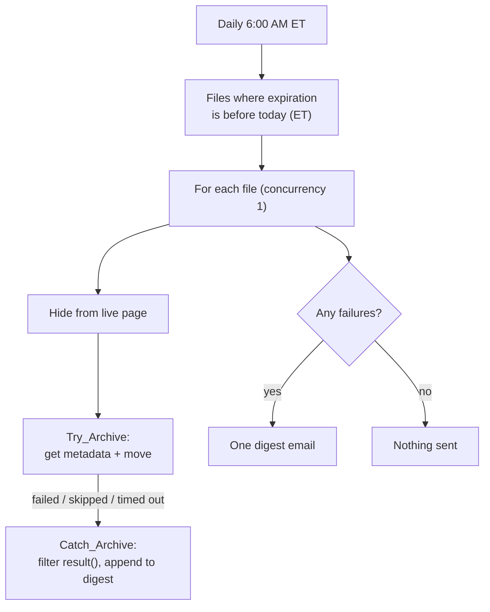

# Rates & Promos: Archive Expired Promotions

Every morning, this flow pulls expired promotions off the member-facing rates page and moves them to an archive library. It handles failures per item, and if anything fails it sends one digest email. A clean day sends nothing.

**Connectors:** SharePoint · Office 365 Outlook  
**Trigger:** Recurrence, daily at 6:00 AM Eastern  
**Size:** 12 actions

## The problem

A review of the existing flow found a real bug and several quiet failure modes:

- **Promos were archived a day early.** The filter used `le utcNow()`, so a promo disappeared on its expiration date instead of after it.
- **A dead filter clause.** `PromoStatus ne 'Archived'` did nothing, because nothing in the flow ever wrote that value.
- **No failure visibility.** A file that failed to move just stayed put.
- **Daylight saving drift.** The recurrence had no time zone, so the run time shifted twice a year.
- **A hidden 100-item cap.** Pagination was off, so a backlog would never clear.
- **Messy connections.** Two different SharePoint connection references were in use.

## What it does

1. **Gets promotions to archive.** It queries the library for files whose `PromoExpirationDate` is **before today's date in Eastern time**, with pagination up to 5,000.
2. **Handles each file in turn,** with concurrency 1:
   - **Hides the promo from the live page** (`ShowonRatesPromos = No`).
   - **Moves the file** (Get file metadata, then Move file) inside a `Try_Archive` scope.
   - **Records any failure.** If the move fails, `Catch_Archive` uses Filter array on `result('Try_Archive')` to find the failed action and adds a line to a failure list: the file name, its ID and the error message.
3. **Reports once.** After the loop, if the failure list isn't empty, it sends one digest email.

## Architecture



## Key design decisions

| Decision | Why |
|---|---|
| **`lt` today's date in Eastern time** | A promo stays live through its expiration date and is archived the next morning. That was confirmed as the intended behavior. |
| **`timeZone` set on the recurrence** | The run stays at 6:00 AM local time year-round. |
| **Hide first, then move** | If the move fails, the promo is already off the member-facing page, and tomorrow's run retries the move. Re-running is harmless. |
| **Filter `result()` rather than `result()[0]`** | `result()` returns every action in the scope, and index 0 isn't necessarily the one that failed. Expressions have no inline filter, so a Filter array action does it. |
| **`coalesce()` on the error message** | A timed-out action can return no error object. A null inside `concat()` would make the error handler itself fail, leaving no signal at all. |
| **An array plus one digest** instead of an email per failure | A bad day produces one actionable email, not a dozen. |
| **Concurrency 1** on the loop | With the default of 20 parallel iterations, appends to the failure array drop entries, so the digest would look complete when it isn't. |

## Lessons from the build

- **Name a scope before anything references it.** Renaming a scope after `runAfter` and `result()` point at it is where dangling references come from.
- **Check the subject line after inserting a dynamic token.** The subject lost its first character, most likely when a token was inserted next to it.
- **Blank expiration dates are safe by default.** OData `lt` comparisons exclude nulls, so evergreen promos with no expiration date are never archived. That's worth knowing if anyone ever treats a blank date as "already expired."

## Open items

- **Verify `nameConflictBehavior`.** The connector's numeric values aren't well documented. For an archive, **Rename** is safer than Replace, because nothing is ever overwritten.
- **Year subfolders** (`/Archive Library/2026`), and an archived-date column on each item.

## Configuration

| Environment variable | Purpose |
|---|---|
| `plb_PromosSiteUrl`, `plb_PromosLibrary` | Site and live promotions library |
| `plb_ArchiveFolderPath` | Destination folder |
| `plb_TechOpsEmail` | Failure digest recipient |

## Action outline

<details>
<summary>Expand the full action tree</summary>

<!-- outline:start -->
```text
Recurrence · Recurrence (Day, Eastern Standard Time)
├─ Initialize_arcFailures · Initialize variable
├─ Get_files_(properties_only) · SharePoint: Get files (properties only)  (pagination 5000)
├─ Apply_to_each · Apply to each  (concurrency 1)
│  ├─ Update_file_properties · SharePoint: Update file properties
│  ├─ Try_Archive · Scope
│  │  ├─ Get_file_metadata · SharePoint: Get file metadata
│  │  └─ Move_file · SharePoint: Move file
│  └─ Catch_Archive · Scope  (runs after Try_Archive [Failed/Skipped/TimedOut])
│     ├─ Filter_array · Filter array
│     └─ Append_to_array_variable · Append to array
└─ Condition_-_Any_failures · Condition
   └─ If yes
      └─ Send_an_email_(V2) · Outlook: Send an email (V2)
```
<!-- outline:end -->

</details>

## Reconstruction notes

- **The update step** writes only `ShowonRatesPromos`. Any other metadata the production flow stamped isn't shown.
