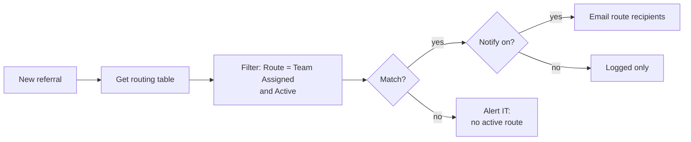

# Branch Referrals: Data-Driven Routing

Routes cross-branch member referrals to the right team. A small SharePoint routing table holds the recipients and replaced a nine-branch Switch. Adding a branch or changing a recipient is now a list edit, not a flow change.

**Connectors:** SharePoint · Office 365 Outlook  
**Trigger:** new item on the *Referral Tracker* list  
**Size:** 8 actions (the flow it replaced had about 27 inside the Switch alone)

## The problem

The original flow used a **Switch** with about nine cases, one per branch or department. Each case held three cloned actions (Select, Compose, Send email) that differed only by recipient address. That caused two kinds of trouble:

- **Every change was a flow edit.** Adding a branch meant cloning three actions and editing hard-coded HTML in several places. A new branch was about to open.
- **The Mortgage team wanted location context.** They asked to capture where the member wants to buy, which would have meant touching every case again.

## What it does

1. **Reads the routing table.** Each row has Route Name, Recipient(s), Active, Notify and Owner.
2. **Finds the route.** It filters the table to the row whose Route Name matches the referral's *Team Assigned* value and is Active.
3. **Builds one email.** It flattens the multi-select *Category* field to plain text and builds a single HTML email: member, account (if applicable), categories, location context, notes, referrer, and a link to claim the referral.
4. **Handles unmatched referrals.** If a route matches and Notify is on, it emails the route's recipients. If **no active route** matches, it alerts IT so a referral is never silently dropped.

New branches are added to the routing table ahead of time with **Active = No.** On opening day, someone flips one toggle, with no flow edit and no republish.

## Architecture



| Route Name (matches the choice value exactly) | Recipient(s) | Active |
|---|---|---|
| Main Office | mainoffice@contoso.com | Yes |
| North Branch | north@contoso.com | Yes |
| Harbor Branch | harbor@contoso.com | Yes |
| Mortgage | mortgage@contoso.com | Yes |
| Consumer Lending | lending@contoso.com | Yes |
| Digital Branch | digital@contoso.com | Yes |
| Retail Team - New Account Opening | teamlead1@contoso.com; teamlead2@contoso.com | Yes |
| New Branch | newbranch@contoso.com | **No** |

## Key design decisions

| Decision | Why |
|---|---|
| **A routing table instead of Switch cases** | Configuration is data. Business owners can see where referrals go, and each row has an Owner to ask when an address is wrong. |
| **Pull the whole table and filter in the flow** | OData filters on Yes/No and choice columns are unreliable. The table is small. |
| **Semicolon-separated recipients** in one column | Nesting a distribution group inside a Microsoft 365 group wasn't workable for the new-accounts route. |
| **Location Context is free text**, shown only when Mortgage is selected | The requester agreed in writing that it's for the lender to read at claim time, not a reportable field. |
| **Team Assigned stays single-select** | Multi-select would break the form's conditional visibility, change the shape the monthly report reads, and break the rollback flow. It also raises a process question with no good answer: if two teams get a referral, who claims it? |
| **An unmatched-route alert** | A bad choice value or an inactive route fails loudly instead of losing a member referral. |

## Lessons from the build

- **Built in parallel with the live flow.** Recipients pointed at the builder during testing, eight test cases passed, and then the old flow was turned off and kept as a rollback.
- **A gap appeared after cutover.** A branch manager pointed out that routes set to *no alert* send no email, and email was how staff found their referrals. The fix is **My Submissions** and **My Claims** list views, so finding a referral doesn't depend on an email.

## Platform watch items

- **Member data.** Referral data includes member information, so permission scoping on the list is a GLBA consideration.
- **List size.** The 5,000-item view threshold will eventually need indexed columns and an archiving plan.
- **Conversion reporting.** Reporting on referral conversion would need a link back to the core banking system, which this design doesn't attempt.

## Configuration

| Environment variable | Purpose |
|---|---|
| `plb_AutomationSiteUrl` | Site that hosts both lists |
| `plb_ReferralTrackerList` | Referral list ID |
| `plb_ReferralRoutingList` | Routing table ID |
| `plb_TechOpsEmail` | Unmatched-route alerts |

**Referral columns used:** Title (member), TeamAssigned (choice), Category (multi-choice), LocationContext, `Account_x0023__x0028_ifapplicabl` (a display name truncated to 32 characters by SharePoint), Notes.

## Action outline

<details>
<summary>Expand the full action tree</summary>

<!-- outline:start -->
```text
When_an_item_is_created · SharePoint: when an item is created
├─ Get_items_-_Referral_Routing · SharePoint: Get items
├─ Filter_array_-_Matching_route · Filter array
├─ Select_Category_Values · Select
├─ Compose_Email_Body · Compose
└─ Condition_-_Route_matched · Condition
   ├─ If yes
   │  └─ Condition_-_Notify_enabled · Condition
   │     └─ If yes
   │        └─ Send_referral_email · Outlook: Send an email (V2)
   └─ If no
      └─ Send_unmatched_route_alert · Outlook: Send an email (V2)
```
<!-- outline:end -->

</details>

## Reconstruction notes

- **Route names and recipients** are placeholders.
- **The email layout** is representative.
